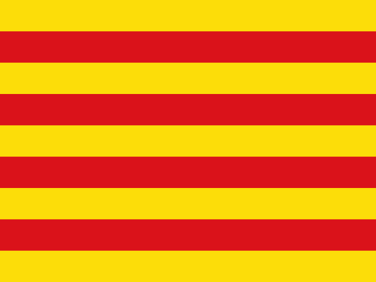

<div align="center">
  <h2>Marc Teyra Galiano</h2>
  <p><b>Agentic Architect</b> · Designing systems, and orchestrating autonomous AI to bring them to life.</p>
</div>

<br/>

<table>
  <tr>
    <td width="260" valign="top" align="center">
      
      <br/>
      <p align="center" style="margin-top: 8px;">
        <sub><b>0 · THE NOMAD</b></sub><br/>
        <sub><i>"Learns enough of everything to navigate any system, build what’s missing, and move on before the dust settles."</i></sub>
      </p>
    </td>
    <td valign="top">

```rust
pub const ARCHITECT: Profile = Profile {
    role:        "Ideator",
    system:      "NixOS 26.11 · CachyOS BORE (hyper-optimized)",
    focus:       "Autonomous Agent Operations & Declarative Systems",
    studies:     "B.Sc. Artificial Intelligence for Biomedical Engineering",

    projects: &[
        "NixCare           — Autonomous NixOS health & telemetry",
        "Wortschatz        — Offline live contextual language tools",
        "NixOS Config      — Flake architecture for mobile workstations",
        "Agentic Secretary — Autonomous personal workflow synthesis and guidance",
    ],

    extracurriculars: &[
        "Biomedical AI & Neural Systems",
        "Autonomous Robotics & Real-time Vision",
        "chillin and livin life to the fullest extent (sometimes)",
    ],
};
```

<div align="left" style="margin-top: 6px;">
  <b>root/</b> &nbsp;
  🇩🇪 Germany &nbsp;·&nbsp;
  🇨🇦 Canada &nbsp;·&nbsp;
   Catalonia

  <br/>
  <b>connect/</b> &nbsp;
  <a href="https://linkedin.com/in/mteyra"><code>linkedin</code></a> &nbsp;·&nbsp;
  <a href="https://x.com/<your_handle>"><code>x</code></a>
</div>
  </tr>
</table>

---

### 🛠️ Active & Upcoming Builds

<table>
  <thead>
    <tr>
      <th align="left" nowrap>Project</th>
      <th align="left">Focus</th>
      <th align="center" nowrap>Status</th>
    </tr>
  </thead>
  <tbody>
    <tr>
      <td nowrap><b><a href="https://github.com/mteyra/nixcare">nixcare</a></b></td>
      <td>Declarative NixOS health scanner, policy cleaner, safe weekly updater &amp; local hardware-potential tracker</td>
      <td nowrap align="center">🟢&nbsp;Live&nbsp;(MIT)</td>
    </tr>
    <tr>
      <td nowrap><b><a href="https://github.com/mteyra/nixos-config">nixos&#8209;config</a></b></td>
      <td>ThinkPad X1 Yoga Gen 3 flake — &lt;6W idle tuning, Wacom EC <code>_Q2A</code> S3 wakeup, 360° hinge daemon</td>
      <td nowrap align="center">🟢&nbsp;Live&nbsp;(MIT)</td>
    </tr>
    <tr>
      <td nowrap><b><a href="https://github.com/mteyra/emacs-german-filetype">wortschatz</a></b></td>
      <td>Offline live green/red German dictionary mode, instant translation &amp; personal Word Vault for <code>.de</code> journals</td>
      <td nowrap align="center">🟡&nbsp;Polishing</td>
    </tr>
  </tbody>
</table>

---

### 🏆 Hackathons & Field Notes

- 🥈 **2nd Place — Orangensaft Hackabot (Apr 2026)**: Designed a real-time computer-vision hand-gesture state machine (`MediaPipe` + `OpenCV` fist-to-open snap and palm-shoo detection) paired with an asynchronous voice-control thread to command a mobile robot at 60 FPS without loop latency.
