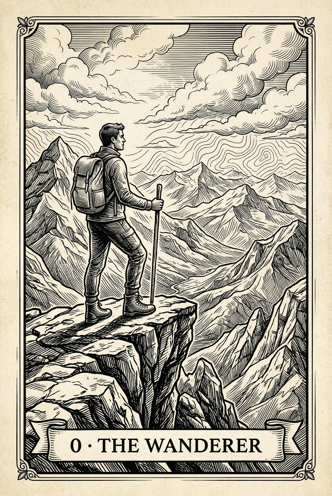

<div align="center">
  <h2>Marc Teyra Galiano</h2>
  <p><b>Agentic Architect</b> · Designing systems, orchestrating autonomous AI to bring them to life.</p>
</div>

<br/>

<table>
  <tr>
    <td width="260" valign="top" align="center">
      
      <br/>
      <p align="center" style="margin-top: 8px;">
        <sub><b>0 · THE WANDERER</b></sub><br/>
        <sub><i>"Learns enough of everything to navigate any system, build what’s missing, and move on before the dust settles."</i></sub>
      </p>
    </td>
    <td valign="top">

```rust
pub struct Profile {
    pub role:      "Agentic Architect",
    pub focus:     "Autonomous Agent Operations & Declarative Systems",
    pub studies:   "B.Sc. Artificial Intelligence for Biomedical Engineering",
    pub nomad:     ["🇩🇪 DE", "🇨🇦 CA", "CAT"],
    pub system_as_of_now: "NixOS 26.11 · CachyOS BORE (hyper-optimized)",
    pub active_builds: [
        "NixCare           — Autonomous NixOS health & telemetry",
        "Wortschatz        — Offline live contextual language tools",
        "Agentic Secretary — Autonomous personal workflow synthesis",
        "NixOS Config      — Flake architecture for mobile workstations",
    ],
    pub extracurricular: [
        "🎾 Competitive tennis",
        "🧗 Bouldering & rock climbing",
        "🗺️ Overland road trips (Baltics, Balkans & beyond)",
    ],
}
```

<div align="left" style="margin-top: 6px;">
  <b>Nomad roots:</b> &nbsp;
  🇩🇪 Germany &nbsp;·&nbsp;
  🇨🇦 Canada &nbsp;·&nbsp;
   Catalonia
</div>

  </td>
  </tr>
</table>

---

### 🛠️ Active & Upcoming Builds

| Project | Focus | Status |
| :--- | :--- | :--- |
| **[`nixcare`](https://github.com/mteyra/nixcare)** | Declarative NixOS health scanner, policy cleaner, safe weekly updater & local hardware-potential tracker | 🟢 **Live (MIT)** |
| **[`nixos-config`](https://github.com/mteyra/nixos-config)** | ThinkPad X1 Yoga Gen 3 flake — <6W idle tuning, Wacom EC `_Q2A` S3 wakeup, 360° hinge daemon | 🟢 **Live (MIT)** |
| **[`wortschatz`](https://github.com/mteyra/emacs-german-filetype)** | Offline live green/red German dictionary mode, instant translation & personal Word Vault for `.de` journals | 🟡 **Polishing** |

---

### 🏆 Hackathons & Field Notes

- 🥈 **2nd Place — Orangensaft Hackabot (Apr 2026)**: Designed a real-time computer-vision hand-gesture state machine (`MediaPipe` + `OpenCV` fist-to-open snap and palm-shoo detection) paired with an asynchronous voice-control thread to command a mobile robot at 60 FPS without loop latency.
- 🗺️ **Overland Travel Atlas**: Topographic journey mapping and travel notes across the Baltics, Balkans, and alpine routes (*6M.2024: Baltics, Balkans & Back*).
